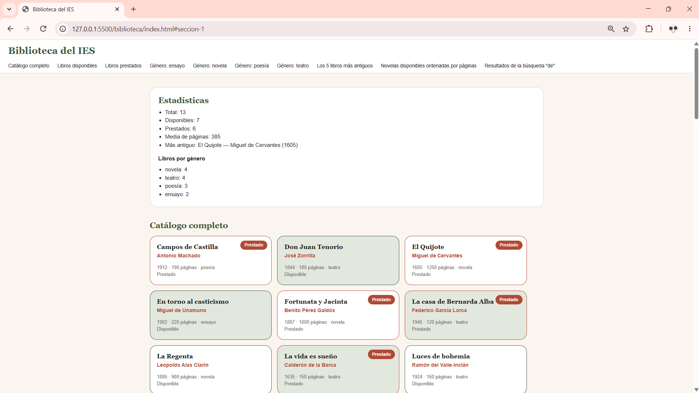
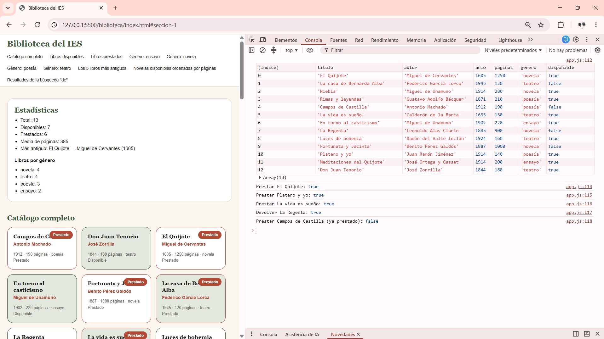
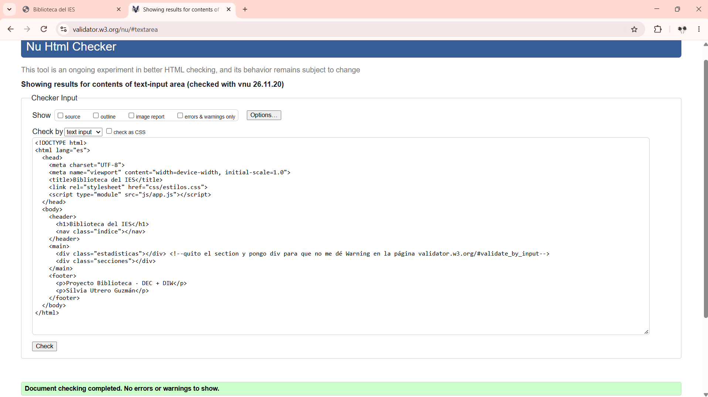
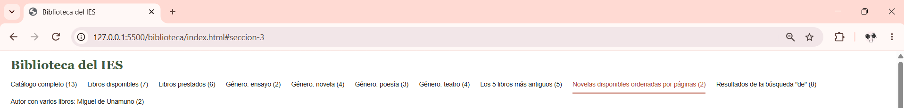
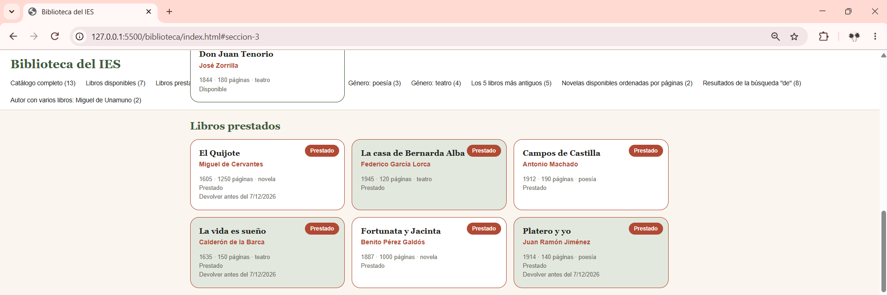
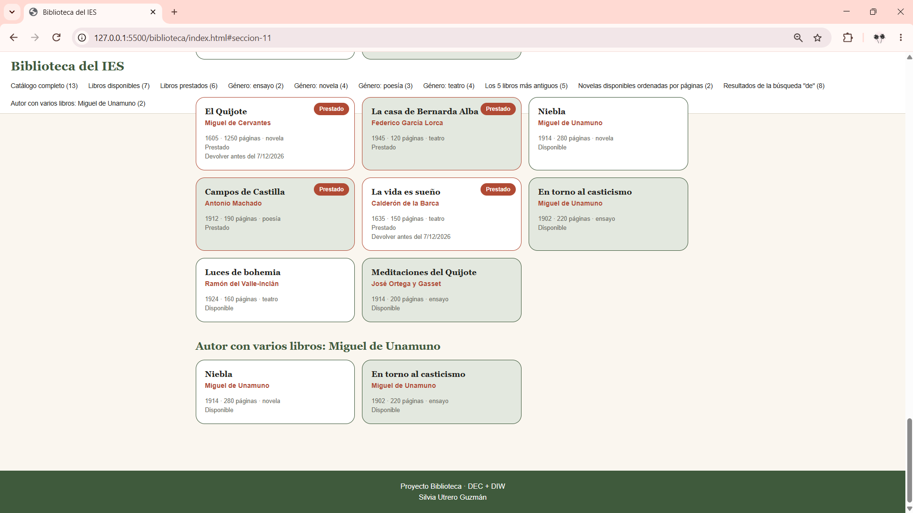

# Biblioteca del IES

Página web que enseña los libros de una biblioteca de varias formas: todos los libros, los disponibles, los prestados, por género, los 5 más antiguos, una búsqueda y unas estadísticas. Toda la página la crea JavaScript cuando se carga. Los libros y sus datos están en las clases Libro y Biblioteca, y el diseño en css/estilos.css.

## Capturas

## Arquitectura

Todo mi programa se ejecuta en el navegador del usuario: él descarga los archivos, ejecuta el JavaScript y pinta la página. El servidor (Live Server, en mi caso) solo manda los archivos y no ejecuta nada de mi código. Los préstamos se pierden al recargar la página porque solo se guardan en la memoria del navegador. Para que se quedaran guardados haría falta un servidor con un programa y una base de datos, y que el navegador le avisara cada vez que se presta un libro.

He usado JavaScript porque es el lenguaje que entienden todos los navegadores y permite cambiar la página sin recargarla. Además de JavaScript, en el navegador se usan HTML y CSS, y también TypeScript (que luego se convierte a JavaScript) y programas como React o Angular, que ayudan a hacer páginas más grandes.

Al cargar los archivos como módulos (type="module"), el navegador espera a leer el HTML antes de ejecutarlos, igual que con defer. Cada archivo va por separado. Lo que un archivo necesita de otro hay que sacarlo con export y cogerlo con import. Los módulos no funcionan si abro el HTML con doble clic, porque el navegador no deja cargar archivos así por seguridad. Por eso uso un servidor local (Live Server).

JavaScript es un lenguaje interpretado: el navegador lo ejecuta tal cual se escribe, sin compilarlo antes, y funciona en cualquier navegador. Pero es más lento que un programa compilado, cualquiera puede ver el código y los errores salen cuando se ejecuta, no antes.

Para escribir el código he usado Visual Studio Code, para verlo funcionar la extensión Live Server, para buscar errores la consola del navegador y para comprobar el HTML el validador del W3C.

## Decisiones

**Cómo junto los filtros.** Los métodos que filtran (filtrarPorGenero, filtrarPorDisponibilidad y buscar) me dan una lista de libros. Como es una lista, le puedo seguir aplicando más filtros u ordenarla. Para "novelas disponibles ordenadas por páginas" primero cojo las novelas con filtrarPorGenero("novela"), después me quedo con las disponibles con filter y al final las ordeno por páginas con toSorted. Así no tengo que crear un método para cada combinación.

**Cómo ordeno sin cambiar la lista original.** En ordenarPor uso toSorted, que ordena una copia y deja this.libros como estaba. Si usara sort, cambiaría la lista original. Si lo que ordeno es texto lo comparo con localeCompare y si es un número hago una resta. Si ascendente es false, cambio el signo del resultado y sale al revés.

**Cómo paso los datos de texto a su tipo en cargarDesdeTexto().** Corto el texto en líneas con split("\n") y cada línea en campos con split(";"). Con trim() quito los espacios que sobran. Todos los campos llegan como texto, así que el año y las páginas los paso a número con Number(). El último ("si" o "no") lo paso a true o false comparando con "si", porque Boolean("no") daría true (cualquier texto que no esté vacío cuenta como true).

## Ampliaciones

- Fecha de devolución prevista: al prestar un libro se guarda la fecha de hoy más 15 días y se muestra en la tarjeta.
- Contador de préstamos: cada libro cuenta las veces que se presta y las estadísticas muestran el más prestado.
- Autores con varios libros: una sección por cada autor que tiene más de un libro, agrupados con un Map.
- Contador por sección: cada enlace del índice muestra cuántos libros tiene su sección.

